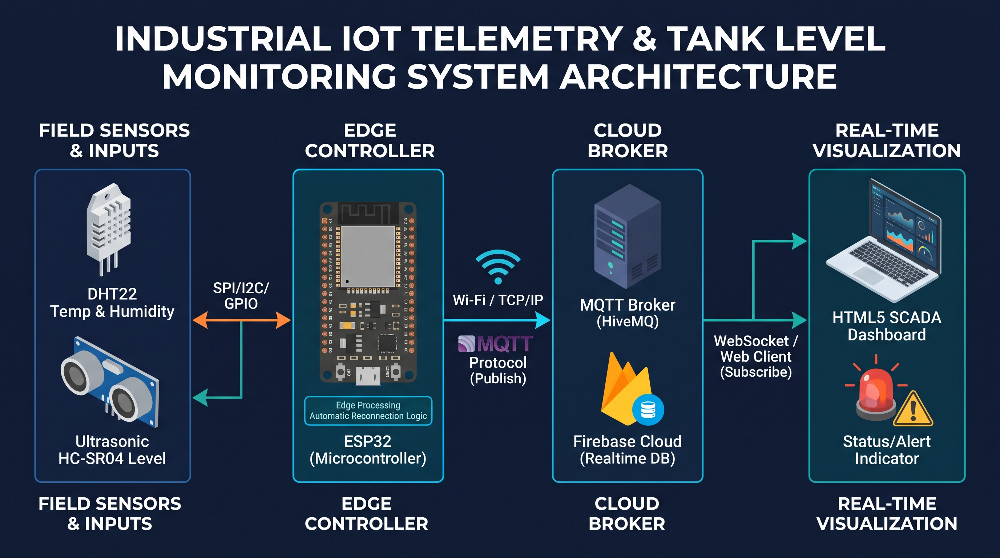

# Industrial Multi-Sensor Telemetry & Tank Level Monitoring System

 

## Executive Summary
Merancang dan mengimplementasikan sistem akuisisi data telemetri berlatensi rendah berbasis mikrokontroler **ESP32** menggunakan protokol **MQTT over WebSockets (Pub/Sub)**. Sistem ini disimulasikan untuk pemantauan parameter kritis pada *Fuel Terminal / Storage Tank* di lingkungan industri proses seperti **Pertamina**, mencakup suhu tangki (*Storage Tank Temp*) dan level ketinggian fluida (*Fluid Level Gauge*).

---

## Technical Features & Engineering Highlights

* **Low-Latency Telemetry**: Transmisi data JSON via MQTT Pub/Sub secara real-time dengan interval pengiriman 2 detik.
* **Edge Threshold Alerting**: Evaluasi kondisi batas aman (*warning threshold*) langsung di tingkat mikrokontroler (ESP32) untuk menyalakan indikator LED lokal dan mengirim sinyal *Alert*.
* **Fault Tolerance & Reliability**: Implementasi *non-blocking auto-reconnection logic* untuk koneksi WiFi dan MQTT Broker tanpa mengganggu pembacaan sensor (*looping main process*).
* **Interactive SCADA/Web Dashboard**: Antarmuka monitoring interaktif berbasis HTML5, CSS3, dan JavaScript (`MQTT.js`) untuk memantau status instrumen lapangan secara berkesinambungan.

---

## Hardware Pinout & Architecture (Wokwi Simulation)

| Component | Pin ESP32 | Function |
| :--- | :--- | :--- |
| **DHT22 (Data)** | GPIO 15 | Storage Tank Temperature & Humidity |
| **HC-SR04 (Trig)** | GPIO 5 | Fluid Level Gauge (Trigger) |
| **HC-SR04 (Echo)**| GPIO 18 | Fluid Level Gauge (Echo) |
| **LED Alert** | GPIO 2 | Local Alarm Indicator |

---

## Tech Stack
* **Microcontroller / Firmware**: ESP32, C++ (Arduino Framework), PubSubClient, ArduinoJson.
* **Network & Protocol**: WiFi, MQTT (TCP/IP & WebSockets), JSON Payload format.
* **Dashboard / Front-End**: HTML5, CSS3, JavaScript (`MQTT.js`).
* **Simulation Tool**: Wokwi Online Emulator.

---

## How to Run Simulation
1. Buka simulasi proyek di [Wokwi Simulation Link](https://wokwi.com/).
2. Jalankan simulasi C++ pada ESP32.
3. Buka file `dashboard.html` di browser lokal kamu.
4. Pastikan status menunjukkan `SYSTEM STATUS: ONLINE` dan data telemetry dari ESP32 akan ter-update secara otomatis secara real-time.
